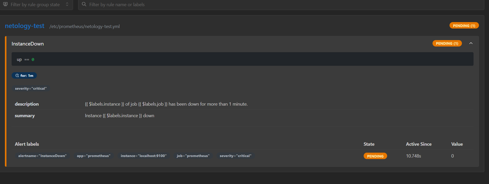
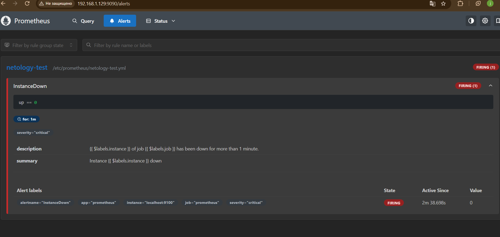
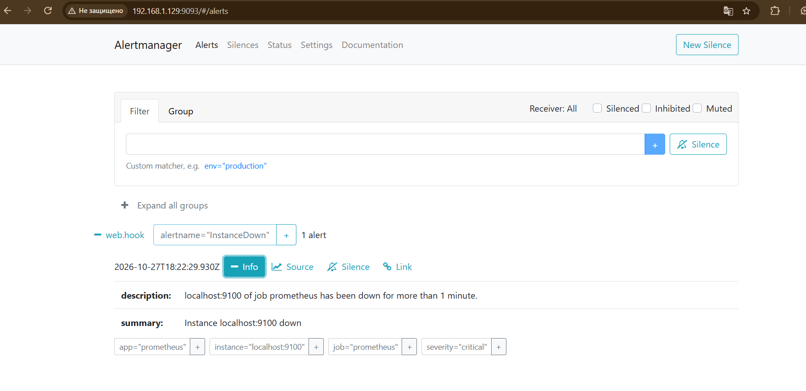
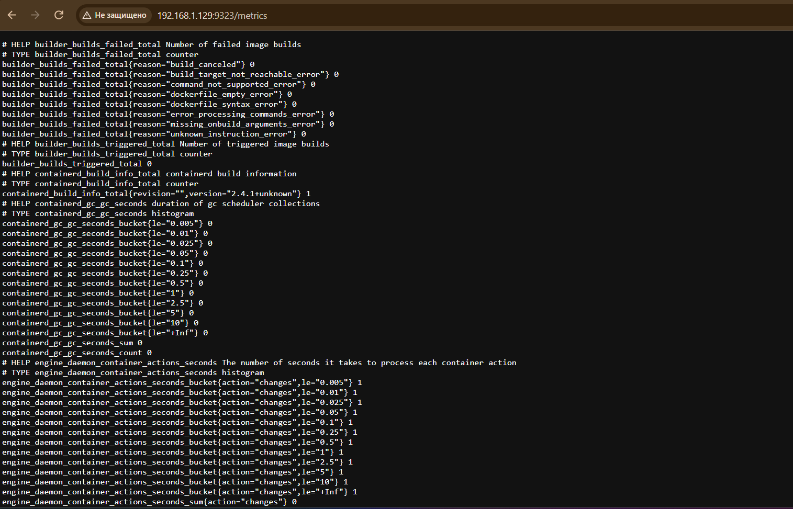
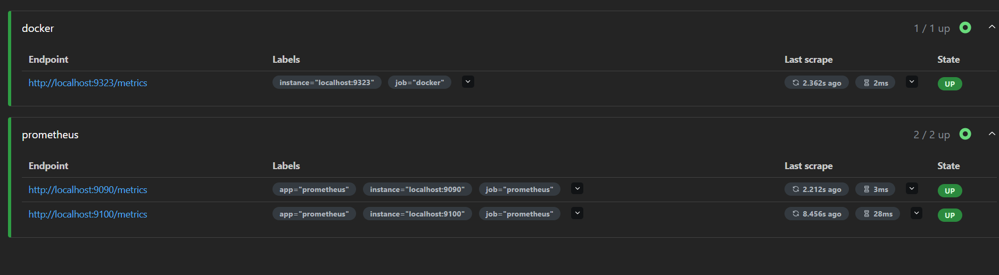

# Домашнее задание к занятию «Prometheus. Часть 2» — Корченко Леонид Владиславович

Стенд: Ubuntu 24.04 `leonid-education` (192.168.1.129), Prometheus 3.13.4, Node Exporter 1.12.1, Alertmanager 0.34.1, Docker 29.9.0, Grafana OSS.

Prometheus и Node Exporter установлены в [первой части](../prometheus%20_hw_1/README.md).

---

### Задание 1

Правило оповещения `InstanceDown`: срабатывает, если таргет не отвечает дольше минуты.

`/etc/prometheus/netology-test.yml`:

```yaml
groups:
  - name: netology-test
    rules:
      - alert: InstanceDown
        expr: up == 0
        for: 1m
        labels:
          severity: critical
        annotations:
          description: '{{ $labels.instance }} of job {{ $labels.job }} has been down for more than 1 minute.'
          summary: Instance {{ $labels.instance }} down
```

Файл подключён в `/etc/prometheus/prometheus.yml`:

```yaml
rule_files:
  - "netology-test.yml"
```

```bash
chown prometheus:prometheus /etc/prometheus/netology-test.yml
promtool check config /etc/prometheus/prometheus.yml
systemctl restart prometheus
systemctl stop node-exporter
```

Node Exporter остановлен, оповещение в статусе Pending:



---

### Задание 2

Установка Alertmanager и интеграция с Prometheus.

1. Скачан архив Alertmanager `linux-amd64` с [GitHub Releases](https://github.com/prometheus/alertmanager/releases).
2. Программы — в `/usr/local/bin`, конфиг — в `/etc/alertmanager`, данные (silences, журнал уведомлений) — в `/var/lib/alertmanager`.
3. Создан сервис, запуск от пользователя `prometheus`.
4. В конфиге Prometheus указан адрес Alertmanager.

```bash
wget https://github.com/prometheus/alertmanager/releases/download/v0.34.1/alertmanager-0.34.1.linux-amd64.tar.gz
tar xvfz alertmanager-0.34.1.linux-amd64.tar.gz
cd alertmanager-0.34.1.linux-amd64

cp alertmanager amtool /usr/local/bin/
mkdir /etc/alertmanager /var/lib/alertmanager
cp alertmanager.yml /etc/alertmanager/
chown -R prometheus:prometheus /etc/alertmanager /var/lib/alertmanager

amtool check-config /etc/alertmanager/alertmanager.yml
```

`/etc/systemd/system/alertmanager.service`:

```ini
[Unit]
Description=Alertmanager Service
After=network.target

[Service]
User=prometheus
Group=prometheus
Type=simple
ExecStart=/usr/local/bin/alertmanager \
  --config.file=/etc/alertmanager/alertmanager.yml \
  --storage.path=/var/lib/alertmanager/
Restart=on-failure

[Install]
WantedBy=multi-user.target
```

```bash
systemctl daemon-reload
systemctl enable --now alertmanager
systemctl status alertmanager --no-pager
```

Адрес Alertmanager в `/etc/prometheus/prometheus.yml`:

```yaml
alerting:
  alertmanagers:
    - static_configs:
        - targets:
            - localhost:9093
```

```bash
promtool check config /etc/prometheus/prometheus.yml
systemctl restart prometheus
```

Node Exporter остановлен, через минуту оповещение перешло в Firing:



Оповещение получено Alertmanager (`http://192.168.1.129:9093`):



После проверки Node Exporter запущен обратно: `systemctl start node-exporter`.

---

### Задание 3

Docker отдаёт собственные метрики в формате Prometheus. Включено в `/etc/docker/daemon.json`:

```json
{
  "metrics-addr": "0.0.0.0:9323"
}
```

```bash
python3 -m json.tool /etc/docker/daemon.json
systemctl restart docker
curl -s localhost:9323/metrics | head -20
```

Эндпоинт `http://192.168.1.129:9323/metrics`:



В `/etc/prometheus/prometheus.yml` добавлен отдельный job:

```yaml
scrape_configs:
  - job_name: "prometheus"
    static_configs:
      - targets: ["localhost:9090", "localhost:9100"]
        labels:
          app: "prometheus"

  - job_name: "docker"
    static_configs:
      - targets: ["localhost:9323"]
```

```bash
promtool check config /etc/prometheus/prometheus.yml
systemctl restart prometheus
```

Status → Target health:


